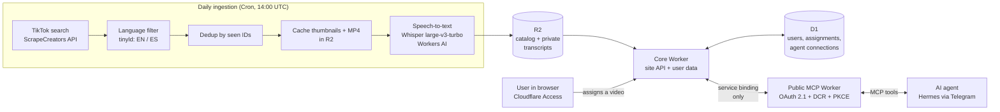

# Insider

Insider is a guide to San Francisco through short videos and community notes, built on top of a production pipeline that turns short-form video into structured, private context that an AI agent can query over MCP.

[Open Insider](https://insider-ingest.juanmontreuil71.workers.dev) (protected by sign-in)

## How it works

1. **Ingestion.** A daily cron job searches TikTok for a topic, drops malformed records and captions that aren't English or Spanish, and skips every ID it has already seen.
2. **Media and transcription.** New thumbnails and videos are cached in R2. The audio is transcribed with Whisper, and the result (full text, timestamped segments, VTT and detected language) is stored privately per video. Transcription is best-effort: a failure never blocks a video from reaching the catalog.
3. **Assignment.** A signed-in user picks videos on the site and assigns them to their AI agent. Assignments live in D1 and are scoped to that user.
4. **Agent access over MCP.** The agent connects to a remote MCP server through OAuth 2.1 (Dynamic Client Registration + PKCE), with Cloudflare Access as the upstream OIDC identity provider. It can list its new videos with transcripts, read one video, and mark videos as viewed once it has summarized them.
5. **Isolation.** The public MCP Worker has no direct access to storage or the database. It reaches the core Worker only through a Cloudflare service binding and an internal secret, so an agent can only ever see its own user's assignments. No tool returns storage keys, media URLs or other users' data.

The full flow was validated end-to-end: an agent fetched its assigned videos and transcripts and wrote the viewed state back to the database.

## Tech stack

| Layer | Technology |
|---|---|
| Compute | Cloudflare Workers (TypeScript), scheduled cron |
| Storage | R2 (media, catalog, transcripts), D1 (users, assignments), KV (OAuth grants) |
| AI | Whisper large-v3-turbo on Workers AI; AI agent integration via MCP |
| Agent protocol | Model Context Protocol (Streamable HTTP), remote server |
| Auth | OAuth 2.1, Dynamic Client Registration, PKCE; Cloudflare Access (OIDC); JWT verification with cached JWKS |
| Data sources | ScrapeCreators (TikTok), Google Maps JavaScript API + Places API |
| Hardening | Per-route rate limiting, input and upload validation, strict CORS, CSP on OAuth pages |

## What you can do

- Search short videos about San Francisco's tech and creative scene.
- Browse places people recommend on the community map.
- Leave a note about a place you enjoyed, with an optional photo.
- Send selected videos to your AI agent for a private summary.

## Repository layout

- `worker/` — core Worker: cron ingestion, transcription, site API, auth, user data.
- `mcp/` — public OAuth-protected MCP server for AI agents.
- `index.html`, `map.html` — the site (community map and video catalog).

Setup, deployment and operational details are in [AGENTS.md](AGENTS.md).
